# Merkle Tree Certificate (MTC) Attestation Implementation Plan

## 1. Overview & References

This document specifies the technical design, architectural details, and step-by-step implementation tasks for adding **Merkle Tree Certificate (MTC) Attestation (`fmt: "mtc"`)** support to `fido2-node-clients`.

### Key Specifications & References
- **WebAuthn Level 4 Specification**: `tmp/index.html`
  - Section 8.10: *Merkle Tree Certificate Attestation Statement Format*
  - Section 10.2.1: *MTC Debug Extension (`mtcDebug` / `mtc-debug`)*
- **MTC Trust Chain Architecture**: `tmp/mtc_trust_chain_architecture.html` (mirrored from [https://ve7jtb.github.io/mtc_trust_chain_architecture.html](https://ve7jtb.github.io/mtc_trust_chain_architecture.html))
- **RFC 9162**: *Certificate Transparency Version 2.0* (§2.1.1 SHA-256 Tree Hashing & Proofs)
- **RFC 9052 / RFC 9053**: *CBOR Object Signing and Encryption (COSE)*

---

## 2. Cryptographic Architecture & Trust Chain

In WebAuthn Level 4 (`fmt: "mtc"`), attestation decouples heavy post-quantum CA root signatures (delivered out-of-band in FIDO MDS3 metadata) from ultra-compact authenticator registration ceremonies (which convey only a 2-field `mtcKeyRef` `{ caId, serial }` and registration signature `attStmt.sig` on the wire).

### Six-Level Cryptographic Trust Model

```mermaid
flowchart TD
    subgraph L0["Level 0: FIDO Alliance Metadata Service (MDS3 TOC / BLOB)"]
        MDS_ROOT["FIDO MDS3 Root CA (X.509)\nVerifies JWS Header x5c Chain"]
        MDS_JWS["MDS3 BLOB JWS Signature\nSigned over Base64URL(Header) || '.' || Base64URL(Payload)"]
        MDS_ROOT --> MDS_JWS
    end

    subgraph L1["Level 1: Vendor X.509 Attestation Root CA"]
        VENDOR_X509["metadata.attestationRootCertificates[]\nSelf-Signed Vendor X.509v3 Root CA (BasicConstraints CA:TRUE)\nPublic Key: SPKI (ML-DSA-87 / alg: -50)"]
        MDS_JWS -->|"Authenticates MetadataStatement for AAGUID"| VENDOR_X509
    end

    subgraph L2["Level 2: Signed MTC Subtree Checkpoint"]
        CKPT_PREIMAGE["FidoMtcSubtreeCheckpoint (80 + len(caId) bytes; 85B for 5B caId)\n'FIDO-MTC-SUBTREE-CHECKPOINT-V1\\0\\0' (32B)\n|| uint16_be(len(caId)) (2B) || caId (NB) || uint16_be(logNumber) (2B)\n|| uint48_be(start) (6B) || uint48_be(end) (6B) || rootHash (32B)"]
        CKPT_SIG["subtrees[].signature (ML-DSA-87 / alg: -50)\nSigned by Vendor X.509 Root CA Private Key"]
        VENDOR_X509 -->|"Verifies subtrees[].signature"| CKPT_SIG
        CKPT_SIG -->|"Authenticates"| CKPT_PREIMAGE
    end

    subgraph L3["Level 3: RFC 9162 SHA-256 Merkle Hash Tree"]
        ROOT_HASH["Subtree Merkle Root: subtrees[].rootHash (32B)"]
        INT_NODE["Interior Merkle Nodes (RFC 9162 §2.1.1)\nParent = SHA-256(0x01 || LeftChild[32] || RightChild[32])\nComputed using sibling hashes in proof"]
        LEAF_HASH["Merkle Leaf Hash at index = (serial & 0xFFFFFFFFFFFF)\nLeafHash = SHA-256(0x00 || FidoMtcLogEntry)"]
        LOG_ENTRY["FidoMtcLogEntry (Binary Preimage — 76B + len(caId) + fw + ext)\nuint16_be(len(caId)) || caId || uint64_be(serial)\n|| uint64_be(notBefore) || uint64_be(notAfter = 253402300799)\n|| aaguid (16B) || fwBytes (0x00 or 0x01||uint64_be(fwVersion))\n|| SHA-256(coseKey) (32B) || uint16_be(len(ext)) || ext"]
        CKPT_PREIMAGE --> ROOT_HASH
        ROOT_HASH ---|"Verified Equal"| INT_NODE
        INT_NODE ---|"Merkle Path Climb"| LEAF_HASH
        LEAF_HASH ---|"SHA-256(0x00 || ...)"| LOG_ENTRY
    end

    subgraph L4["Level 4: Batch / Enterprise Attestation Key (COSE_Key)"]
        KEY_REF["Wire Lookup Key: 2-Field mtcKeyRef\nattStmt.mtcCert = { caId, serial } (~22B CBOR)"]
        COSE_KEY["Canonical CBOR COSE_Key\n{ 1: 7, 3: alg (-48..-50 / -7), -1: pub }\nalg inside COSE_Key (label 3) is authoritative"]
        LOG_ENTRY -->|"Commits 32-byte SHA-256(coseKey)"| COSE_KEY
        KEY_REF -.->|"Resolves entry by (caId, serial)"| COSE_KEY
    end

    subgraph L5["Level 5: Authenticator Registration Signature (Wire)"]
        VERIF_DATA["verificationData = authenticatorData || SHA-256(clientDataJSON)\n(Raw byte concatenation; no outer pre-hash)"]
        ATT_SIG["attStmt.sig (alg = attStmt.alg, matching coseKey[3])\nSigned by Authenticator Batch Private Key"]
        COSE_KEY -->|"Verifies attStmt.sig"| ATT_SIG
        ATT_SIG -->|"Signs raw bytes"| VERIF_DATA
    end
```



### Summary of Signed and Hashed Preimages

| Level | Artifact | Location | Cryptographic Operation | Signer / Key | Exact Preimage |
|---|---|---|---|---|---|
| **0** | MDS3 BLOB | FIDO MDS3 Endpoint | Digital Signature (RS256/ES256/ES384) | FIDO MDS3 Root CA | `Base64URL(Header) \|\| "." \|\| Base64URL(Payload)` |
| **1** | Vendor X.509 Root CA | MDS3 `metadata.attestationRootCertificates[]` | Self-Signed X.509v3 Certificate | Vendor Root CA (ML-DSA-87) | ASN.1 DER `TBSCertificate` containing Root SPKI |
| **2** | Subtree Checkpoint | MDS3 `mtcTrustAnchors[].subtrees[]` | Digital Signature (ML-DSA-87, `alg: -50`) | Vendor Root CA Private Key | `FidoMtcSubtreeCheckpoint` (85B for 5B `caId`) |
| **3a** | Merkle Interior Nodes | Computed during verification | SHA-256 (RFC 9162 §2.1.1) | Keyless Hash (`0x01` domain prefix) | `0x01 \|\| LeftChildHash[32] \|\| RightChildHash[32]` |
| **3b** | Merkle Leaf Node | Computed at `serial & 0xFFFFFFFFFFFF` | SHA-256 (RFC 9162 §2.1.1) | Keyless Hash (`0x00` domain prefix) | `0x00 \|\| FidoMtcLogEntry` (82B typical) |
| **4** | Key Commitment | Inside `FidoMtcLogEntry.pkHash` | SHA-256 over raw CBOR COSE_Key | Keyless Hash | Canonical CBOR bytes of `coseKey` |
| **5** | Attestation Signature | `attStmt.sig` on the wire | Digital Signature (`attStmt.alg`) | Authenticator Batch Private Key | `verificationData = authenticatorData \|\| SHA-256(clientDataJSON)` |

---

## 3. Data Formats & Binary Encodings

### 3.1 `FidoMtcSubtreeCheckpoint` Binary Preimage (Level 2)
Signed by the Vendor ML-DSA-87 Root CA to authenticate the subtree root hash covering up to $2^{48}$ batch keys:

```
+--------+--------+-------------+---------------------------------------+
| Offset | Length | Field       | Encoding / Value                      |
+--------+--------+-------------+---------------------------------------+
| 0      | 32     | domainSep   | ASCII "FIDO-MTC-SUBTREE-CHECKPOINT-V1"|
|        |        |             | padded with two trailing 0x00 bytes   |
+--------+--------+-------------+---------------------------------------+
| 32     | 2      | caIdLen     | uint16_be(len(caId))                  |
+--------+--------+-------------+---------------------------------------+
| 34     | N (5)  | caId        | Raw bytes of the CA Identifier        |
+--------+--------+-------------+---------------------------------------+
| 34+N   | 2      | logNumber   | uint16_be(subtrees[].logNumber)       |
+--------+--------+-------------+---------------------------------------+
| 36+N   | 6      | start       | uint48_be(subtrees[].start)           |
+--------+--------+-------------+---------------------------------------+
| 42+N   | 6      | end         | uint48_be(subtrees[].end)             |
+--------+--------+-------------+---------------------------------------+
| 48+N   | 32     | rootHash    | Raw 32-byte SHA-256 subtree root hash |
+--------+--------+-------------+---------------------------------------+
Total Size = 80 + N bytes (85 bytes when N = 5)
```

### 3.2 `FidoMtcLogEntry` Binary Preimage (Level 3b)
Constructed to compute the leaf hash `LeafHash = SHA-256(0x00 || FidoMtcLogEntry)`:

```
+--------------+-----------+--------------------------------------------+
| Field        | Size      | Encoding / Value                           |
+--------------+-----------+--------------------------------------------+
| caIdLen      | 2 bytes   | uint16_be(len(caId))                       |
| caId         | N bytes   | Raw bytes of attStmt.mtcCert.caId          |
| serial       | 8 bytes   | uint64_be(attStmt.mtcCert.serial)          |
| notBefore    | 8 bytes   | uint64_be(notBefore) (Unix epoch seconds)  |
| notAfter     | 8 bytes   | uint64_be(253402300799) (9999-12-31 sentinel)|
| aaguid       | 16 bytes  | Raw 16-byte AAGUID from authenticatorData  |
| fwBytes      | 1 or 9 B  | 0x00 if fwVersion is null; 0x01||uint64_be |
| pkHash       | 32 bytes  | SHA-256(coseKey)                           |
| extLen       | 2 bytes   | uint16_be(len(extensions)) (0x0000 default)|
| extensions   | M bytes   | Raw extension bytes (empty by default)     |
+--------------+-----------+--------------------------------------------+
Total Size = 76 + N + (1 or 9) + M bytes (82 bytes when N=5, fw=null, ext=empty)
```

### 3.3 Wire Attestation Statement Format (`fmt: "mtc"`)
```cddl
$$attStmtType //= (
    fmt: "mtc",
    attStmt: mtcStmtFormat
)

mtcStmtFormat = {
    alg: COSEAlgorithmIdentifier, ; e.g. -50 (ML-DSA-87), -49 (ML-DSA-65), -48 (ML-DSA-44), -7 (ES256)
    sig: bytes,                   ; Raw signature over authenticatorData || clientDataHash
    mtcCert: mtcKeyRef
}

mtcKeyRef = {
    caId: bytes,                  ; Compact CA identifier (e.g. 5-byte OID)
    serial: uint                  ; 64-bit integer: (logNumber << 48) | leafIndex
}
```

### 3.4 In-Band Diagnostic Extension (`mtcDebug` / `mtc-debug`)
Per WebAuthn Level 4 §10.2.1:
- **Authenticator Data Extension** (`authenticatorData.extensions["mtc-debug"]`):
  ```cddl
  mtc-debug: {
      pubKey: bytes,              ; Canonical CBOR-encoded COSE_Key
      ? notBefore: uint,
      ? notAfter: uint,
      ? firmwareVersion: uint,
      ? mtcProof: bytes,          ; Binary RFC 9162 Merkle inclusion proof
      ? rootHash: bytes,          ; Subtree root hash
      ? deviceSerial: tstr
  }
  ```
- **Client Extension Output** (`clientExtensionResults.mtcDebug`):
  Dictionary exposed via `PublicKeyCredential.getClientExtensionResults().mtcDebug`, with ArrayBuffers base64url-encoded when serialized via `toJSON()`.

---

## 4. Deprecation & Modernization Policy on `jsrsasign`

- **Constraint**: **NEVER** use `jsrsasign` in any new MTC code or updated functions.
- **Replacement Strategy**:
  - Cryptographic operations (signing, verification, key generation, hashing): Use `node:crypto` and `crypto.subtle` (WebCrypto API).
  - Buffer / Encoding conversions (hex, base64, base64url, UTF-8, integer packing): Use native `Buffer`, `Uint8Array`, and `DataView`.
  - ASN.1 / X.509 parsing: Use the existing native BER/DER parser in `mycertutil.js`.
  - CBOR encoding / decoding: Use `cbor` package with `prepareBAForCBOR` / `coseKeyToMap`.

---

## 5. Detailed Task Breakdown

```mermaid
gantt
    title MTC Implementation Plan Phases
    dateFormat  X
    axisFormat %s
    section Phase 1: Cryptographic Primitives
    Task 1.1 MTC Preimages & Merkle Tree in mycertutil.js :0, 1
    Task 1.2 ML-DSA SPKI & Native Encoders in mykeyutil.js :0, 1
    section Phase 2: Root CA & Tools
    Task 2.1 OpenSSL 3.6+ Script in generate_attestation_certs.sh :1, 2
    Task 2.2 Node.js Cert Generator in generate_attestation_certs.js :1, 2
    section Phase 3: Authenticator Attestation
    Task 3.1 buildMTCAttestationStatement in fidoutils.js :2, 3
    Task 3.2 Wire integration in processCredentialCreationOptions :2, 3
    section Phase 4: Diagnostic Extension
    Task 4.1 mtcDebug Authenticator & Client Output :3, 4
    section Phase 5: Relying Party Verification
    Task 5.1 6-Level Verification Pipeline in fidoutils.js :4, 5
    section Phase 6: Testing & Validation
    Task 6.1 End-to-End Test Suite in test_mtc.js :5, 6
```



---

### Task 1: Cryptographic Primitives & MTC Helper Functions
**Target Files**: `mycertutil.js`, `mykeyutil.js`

- [x] **1.1 Implement MTC Preimage Serializers in `mycertutil.js`**:
  - `buildFidoMtcSubtreeCheckpoint({ caId, logNumber, start, end, rootHash })`
  - `buildFidoMtcLogEntry({ caId, serial, notBefore, notAfter, aaguid, firmwareVersion, coseKeyBytes, extensions })`
  - `computeFidoMtcLeafHash(logEntryBytes)`
- [x] **1.2 Implement RFC 9162 Merkle Tree Functions in `mycertutil.js`**:
  - `buildRFC9162MerkleTree(leafHashes)`: Computes interior node hashes (`SHA-256(0x01 || left || right)`) and generates inclusion proofs.
  - `verifyRFC9162MerkleProof({ leafHash, proof, leafIndex, start, end, rootHash })`: Climbs the tree from leaf to root according to relative index bit parity.
- [x] **1.3 Add Post-Quantum X.509 SPKI Support in `mykeyutil.js`**:
  - Update `getPublicKeyFromCertBytes` to accept ML-DSA SPKI OIDs:
    - `2.16.840.1.101.3.4.3.17` (ML-DSA-44, `algId: -48`)
    - `2.16.840.1.101.3.4.3.18` (ML-DSA-65, `algId: -49`)
    - `2.16.840.1.101.3.4.3.19` (ML-DSA-87, `algId: -50`)
- [x] **1.4 Add Native Encoding Utilities in `mykeyutil.js`**:
  - Export native `toHex`, `fromHex`, `toBase64Url`, `fromBase64Url`, `toBase64`, `fromBase64` using `Buffer` to avoid `jsrsasign`.

**Verification**:
- Run `npm run test:mtc-primitives` (`test_mtc_primitives.js`, `node:test`) to validate preimage bytes, leaf hash computation, and RFC 9162 Merkle proof evaluation against known test vectors.

---

### Task 2: ML-DSA-87 Root CA & Attestation Certificate Generation  ✅ COMPLETE
**Target Files**: `certs/generate_attestation_certs.sh`, `certs/generate_attestation_certs.js` (also `certs/cleanup.sh`)

- [x] **2.1 Update Shell Script (`certs/generate_attestation_certs.sh`)**:
  - Generate ML-DSA-87 Root CA private key: `openssl genpkey -algorithm mldsa87 -out rootCA-mldsa87.key`.
  - Generate self-signed Root CA cert: `openssl req -x509 -new -key rootCA-mldsa87.key -subj "/C=US/O=IBM/CN=FIDOTEST-MTC-ROOT" -days 9999 -out rootCA-mldsa87.pem`.
  - Generate authenticator batch keypair (ML-DSA-87 or ML-DSA-44) and `mtc.aaguid`.
  - Run Node generator to compute MTC leaf, signed checkpoint, `fidotest-mtc.json` (MDS3 metadata statement), and `.env` `FIDO2_CLIENT_CONFIG` snippet.
- [x] **2.2 Update JavaScript Generator (`certs/generate_attestation_certs.js`)**:
  - Generate ML-DSA-87 root CA keypair using `node:crypto.generateKeyPairSync('ml-dsa-87')`.
  - Generate batch attestation keypair (`alg: -50` ML-DSA-87 or `-48` ML-DSA-44).
  - Construct `FidoMtcLogEntry` for leaf 0, build Merkle tree, and calculate `rootHash` and `proof`.
  - Construct `FidoMtcSubtreeCheckpoint` for `[0, 1024)` and sign with ML-DSA-87 Root CA private key.
  - Produce `fidotest-mtc.json` containing `mtcTrustAnchors`, `subtrees`, `batchKeys`, and `attestationRootCertificates`.
  - Update `fido2ClientConfigJSON` output to include `mtc` configuration block.

**Verification**:
- Execute `./certs/generate_attestation_certs.sh` and `node certs/generate_attestation_certs.js`.
- Confirm `fidotest-mtc.json` contains valid MDS3 schema 3 metadata with `mtcTrustAnchors`.

**Implementation notes (Task 2 — read before starting Tasks 3-6)**:

*How the two scripts cooperate*
- The `.sh` script creates the OpenSSL-native artifacts (`mtc.aaguid`, `rootCA-mldsa87.key`, `rootCA-mldsa87.pem`, `mtc-batch.key`) only if they do not already exist, then runs `node generate_attestation_certs.js --mtc-only`. In that mode the node script generates only the MTC artifacts and prints just the `mtc` JSON block to **stdout** (all progress goes to stderr). The `.sh` script embeds that block as `"mtc":{...}` in its `FIDO2_CLIENT_CONFIG=` output line.
- Run standalone (`node certs/generate_attestation_certs.js`, no flag), the node script does everything it did before and also adds `"mtc": generateMTC()` to `FIDO2_CLIENT_CONFIG`. If run without the `.sh` script it creates the ML-DSA keys/cert itself.
- Both scripts are idempotent (existing files are reused) and must be run from the `certs/` directory (relative file names, as before). `certs/cleanup.sh` now also removes the MTC artifacts. `certs/.gitignore` already covers the new files (`*.key`, `*.pem`, `*.aaguid`, `fidotest-*.json`).
- Requires OpenSSL 3.5+ (tested with 3.6.4) and Node 24+ (ML-DSA in `node:crypto`; tested with 24.11.0).

*Generated artifacts (in `certs/`, git-ignored)*
- `rootCA-mldsa87.key` / `.pem`: ML-DSA-87 (alg -50) self-signed root CA, DN `/C=US/O=IBM/CN=FIDOTEST-MTC-ROOT`, `CA:TRUE`, keyUsage `keyCertSign,cRLSign`, 9999 days. When created by the node script the DER is hand-built with small ASN.1 helpers (node:crypto cannot create certs and jsrsasign cannot do ML-DSA); `openssl verify -CAfile rootCA-mldsa87.pem rootCA-mldsa87.pem` returns OK for both creation paths.
- `mtc-batch.key`: **ML-DSA-44 (alg -48)** authenticator batch key (PKCS#8 PEM). The plan allowed -48 or -50; -48 was chosen to keep signatures small (2420 B) and to match the spec example. Change `MTC_BATCH_ALG` / the key type in the `.js` and `mldsa44` in the `.sh` to switch.
- `mtc.aaguid`: lowercase dashed UUID (the format used by the other `*.aaguid` files).
- `fidotest-mtc.json`: MDS3 schema 3 metadata statement (`description`, `aaguid`, `protocolFamily: fido2`, `schema: 3`, `attestationTypes: [basic_full]`, `attestationRootCertificates: [<b64 DER>]`, `icon`) plus `mtcTrustAnchors`.

*`mtcTrustAnchors` JSON shape produced (Task 5 should consume exactly this)*
```jsonc
"mtcTrustAnchors": [{
  "caId": "<base64 of 83 99 3f 01 01>",
  "subtrees": [{ "logNumber": 1, "start": 0, "end": 1024,
                 "rootHash": "<base64 32B>", "alg": -50, "signature": "<base64 ML-DSA-87 sig over FidoMtcSubtreeCheckpoint>" }],
  "batchKeys": [{ "serial": 281474976710656,        // (logNumber << 48) | leafIndex, = 2^48 for log 1 / index 0
                  "coseKey": "<base64 canonical CBOR { 1:7, 3:-48, -1:pub }>",
                  "notBefore": <unix secs>, "notAfter": 253402300799,
                  "mtcProof": "<base64 of the 32B sibling hashes concatenated, leaf -> root, 10 hashes = 320 B>" }]
}]
```
- All binary values in the metadata file are **standard base64** (consistent with `attestationRootCertificates`). `serial` is a plain JSON number (exact, since `< 2^53` for the test log number); use `BigInt` when handling serials with large `logNumber`.
- Leaf index in the subtree is `serial & 0xFFFFFFFFFFFF`; `mtcProof` must be split into 32-byte chunks before calling `verifyRFC9162MerkleProof`.
- The tree is a full 1024-leaf RFC 9162 tree (`[0, 1024)`). Only leaf 0 is the real batch key's `FidoMtcLogEntry` (fw version null, no extensions, 82 B for the 5 B caId); the other 1023 leaves are deterministic placeholders `SHA-256(0x00 || "FIDOTEST-MTC-PLACEHOLDER-LEAF-<i>")`. The generator verifies the proof and the checkpoint signature before writing.
- The `FidoMtcLogEntry.pkHash` commits to `SHA-256(coseKeyBytes)` where `coseKeyBytes` is `cbor.encodeCanonical(new Map([[1,7],[3,alg],[-1,pub]]))` — the same bytes stored (base64) in `batchKeys[].coseKey`. Task 3/4 must send/commit these exact bytes (do not re-encode the key differently).

*`mtc` block added to `FIDO2_CLIENT_CONFIG` (all binary values are **hex**, matching the `packed` block's style)*
```jsonc
"mtc": { "aaguid": "<dashed uuid>", "caId": "83993f0101", "serial": 281474976710656, "alg": -48,
         "privateKeyHex": "<PKCS#8 DER hex of the batch key>",   // load via mykeyutil.getPrivateKeyFromHex(alg, hex)
         "coseKey": "<hex canonical CBOR COSE_Key>", "notBefore": <secs>, "notAfter": 253402300799,
         "mtcProof": "<hex concatenated sibling hashes>", "rootHash": "<hex 32B>" }
```
This is what `fidoutilsConfig.mtc` (Task 3.1) and the `mtc-debug` extension (Task 4: `pubKey`=coseKey, `notBefore`, `notAfter`, `mtcProof`, `rootHash`) should read. Note `serial` in the config is a JS number (< 2^53); convert with `BigInt(...)` / keep as a CBOR uint when building `attStmt.mtcCert`.

*Verification performed*
- `./certs/generate_attestation_certs.sh` (from a clean directory) exits 0, produces all artifacts, and the emitted `mtc` block parses as JSON. Node standalone run also emits `"mtc"`.
- An independent script re-verified from the generated files: checkpoint is 85 B and its ML-DSA-87 signature verifies against the cert in `attestationRootCertificates[0]`; `FidoMtcLogEntry` is 82 B; the Merkle proof (10 siblings) climbs to `rootHash` via `verifyRFC9162MerkleProof`; the COSE_Key decodes to `{1:7, 3:-48, -1:<1312 B>}` and matches `mtc-batch.key`; `privateKeyHex` from the config imports and produces signatures that verify with the batch public key.
- `npm run test:mtc-primitives`: 28 pass, 0 fail (no regressions in Task 1).
- Not yet covered by an automated test; Task 6 (`test_mtc.js`) should include a generator-output sanity test.

*Known issues / caveats*
- *Fixed (was pre-existing)*: PEM files written by the jsrsasign path (`rootCA.pem`, `u2f.pem`, `packed.pem`, `tpm.pem`, `tpminter.pem`) are CRLF-terminated, so the `.sh` script's `tr -d '\n'` left `\r` in the base64 cert strings and the `FIDO2_CLIENT_CONFIG=` line was not valid JSON when those files already existed. All nine `tr -d '\n'` extractions in `generate_attestation_certs.sh` now use `tr -d '\r\n'`. Verified: with the existing CRLF PEMs the emitted `FIDO2_CLIENT_CONFIG=` value parses as JSON and each `cert`/`tpmIntercert` equals the base64 DER of its PEM file.
- `fidoutils.js` still does not read `fidoutilsConfig.mtc`; that is Task 3. The `jsrsasign` import in the node generator remains only for the legacy U2F/packed/TPM code; none of the new MTC code uses it.
- Changing an existing `fidotest-mtc.json` is not detected: delete `fidotest-mtc.json` (or run `cleanup.sh`) to regenerate the tree/checkpoint after replacing keys or the AAGUID.

*Next up*: **Task 4** (In-Band Diagnostic Extension `mtcDebug` / `mtc-debug`).

---

### Task 3: Build Authenticator MTC Attestation Statement  ✅ COMPLETE
**Target Files**: `fidoutils.js`

- [x] **3.1 Implement `buildMTCAttestationStatement`**:
  - Extract MTC config (`caId`, `serial`, `alg`, `privateKeyHex` / `privateKey`) from `fidoutilsConfig.mtc`.
  - Construct `verificationData = Buffer.concat([Buffer.from(authData), Buffer.from(clientDataHash)])` (raw bytes, no outer pre-hash).
  - Generate signature `sig = await mykeyutil.signBytesWithPrivateKey(alg, privateKey, verificationData)`.
  - Construct and return `attStmt`:
    ```javascript
    {
      "alg": alg,
      "sig": prepareBAForCBOR(sig),
      "mtcCert": {
        "caId": prepareBAForCBOR(caId),
        "serial": serial
      }
    }
    ```
- [x] **3.2 Integrate with `processCredentialCreationOptions`**:
  - Handle `attestationFormat === "mtc"`.
  - Package `attestationObject = { fmt: "mtc", attStmt, authData: prepareBAForCBOR(authData) }`.
  - Retain `buildMTCAttestationStatement` as an internal helper within `fidoutils.js` matching `buildPackedAttestationStatement`, `buildFidoU2FAttestationStatement`, and `buildTPMAttestationStatement`.
  - Fixed 64-bit uint decoding constant definitions (`POW_2_24`, `POW_2_32`, `POW_2_53`) in `cbor.decode` override.

**Verification**:
- Automated unit tests added to `test_mtc_primitives.js`:
  - `processCredentialCreationOptions: creates valid fmt: "mtc" attestation statement` (verifies CBOR encoding, CDDL structure, AAGUID inclusion, and signature validity over raw `authData || clientDataHash` with ML-DSA-44 batch key).
  - `processCredentialCreationOptions: supports ML-DSA-87 (alg -50) batch keys for MTC` (verifies ML-DSA-87 batch key signing and verification).
- `npm run test:mtc-primitives` executed: 30 pass, 0 fail.

---

### Task 4: In-Band Diagnostic Extension (`mtcDebug` / `mtc-debug`)
**Target Files**: `fidoutils.js`

- [ ] **4.1 Authenticator Data Extension Generation**:
  - When `cco.publicKey.extensions?.mtcDebug === true` and `attestationFormat === "mtc"`:
    - Build `mtc-debug` CBOR map: `{ pubKey, notBefore, notAfter, firmwareVersion, mtcProof, rootHash, deviceSerial }`.
    - Set extension flag `0x80` in `authData` flags byte.
    - Append CBOR-encoded extensions to `authData`.
- [ ] **4.2 Client Extension Output Handling**:
  - Populate `result.spkc.getClientExtensionResults.mtcDebug`.
  - Ensure correct Base64URL string encoding of `pubKey`, `mtcProof`, and `rootHash` when converted to JSON.

**Verification**:
- Perform registration with `extensions: { mtcDebug: true }` and confirm presence of `authenticatorData.extensions["mtc-debug"]` and `clientExtensionResults.mtcDebug`.

---

### Task 5: Relying Party MTC Attestation Verification
**Target Files**: `fidoutils.js`

- [ ] **5.1 Implement `verifyMTCAttestation(attestationObject, clientDataHash, mdsMetadata)`**:
  - **Step 1**: Validate CDDL syntax of `fmt: "mtc"` and `attStmt`.
  - **Step 2**: Reconstruct `verificationData = authData || clientDataHash`.
  - **Step 3**: Resolve attestation key, timestamps, and Merkle proof from `mdsMetadata.mtcTrustAnchors[].batchKeys[]` (or in-band `authData.extensions["mtc-debug"]`).
  - **Step 4 (Level 5)**: Verify `attStmt.sig` over `verificationData` with `batchPubKey`.
  - **Step 5**: Check validity window: `notBefore <= now <= notAfter`.
  - **Step 6 (Levels 3 & 4)**: Reconstruct `FidoMtcLogEntry`, compute `LeafHash = SHA-256(0x00 || entry)`, evaluate Merkle proof to derive `computedRootHash`, and verify `computedRootHash === subtrees[].rootHash`.
  - **Step 7 (Levels 1 & 2)**: Reconstruct `FidoMtcSubtreeCheckpoint` (85B) and verify `subtrees[].signature` using Vendor Root CA certificate (`rootCA-mldsa87.pem`, `alg: -50`).

**Verification**:
- Verify valid registrations succeed and verify that tampering with any field (signature, AAGUID, serial, public key, or proof) fails verification.

---

### Task 6: Comprehensive Integration Testing & Configuration
**Target Files**: `test_mtc.js`, `.env.example`, `package.json`

- [ ] **6.1 Create `test_mtc.js` Integration Test Runner**:
  - Test 1: Full registration and verification with FIDO MDS3 metadata.
  - Test 2: In-band registration and autonomous verification with `mtcDebug` extension.
  - Test 3: Negative security tests (invalid signature, altered AAGUID, forged leaf, bad Merkle path, expired timestamp, tampered checkpoint).
- [ ] **6.2 Update Configuration Documentation & Environment**:
  - Document `mtc` block in `.env.example`.
  - Add npm script `"test:mtc": "node test_mtc.js"` to `package.json`.

**Verification**:
- Run `npm run test:mtc` and all regression tests.

---

## 6. Verification & Acceptance Criteria

1. **Standards Compliance**: Attestation statement matches WebAuthn Level 4 §8.10 CDDL syntax and passes strict CBOR decoding.
2. **Cryptographic Rigor**:
   - `FidoMtcSubtreeCheckpoint` is verified with ML-DSA-87 (`alg: -50`) against Vendor Root CA.
   - `FidoMtcLogEntry` binds `aaguid`, `serial`, `notBefore`, `notAfter`, and `SHA-256(coseKey)`.
   - Merkle proof evaluation follows RFC 9162 domain separation (`0x00` leaf, `0x01` interior node).
   - `attStmt.sig` signs raw `authenticatorData || clientDataHash` without outer pre-hashing.
3. **No `jsrsasign` Dependency**: All new code and utilities use native Node.js / WebCrypto APIs.
4. **Autonomous Testing Support**: The `mtcDebug` extension enables complete offline verification without external MDS network calls.
